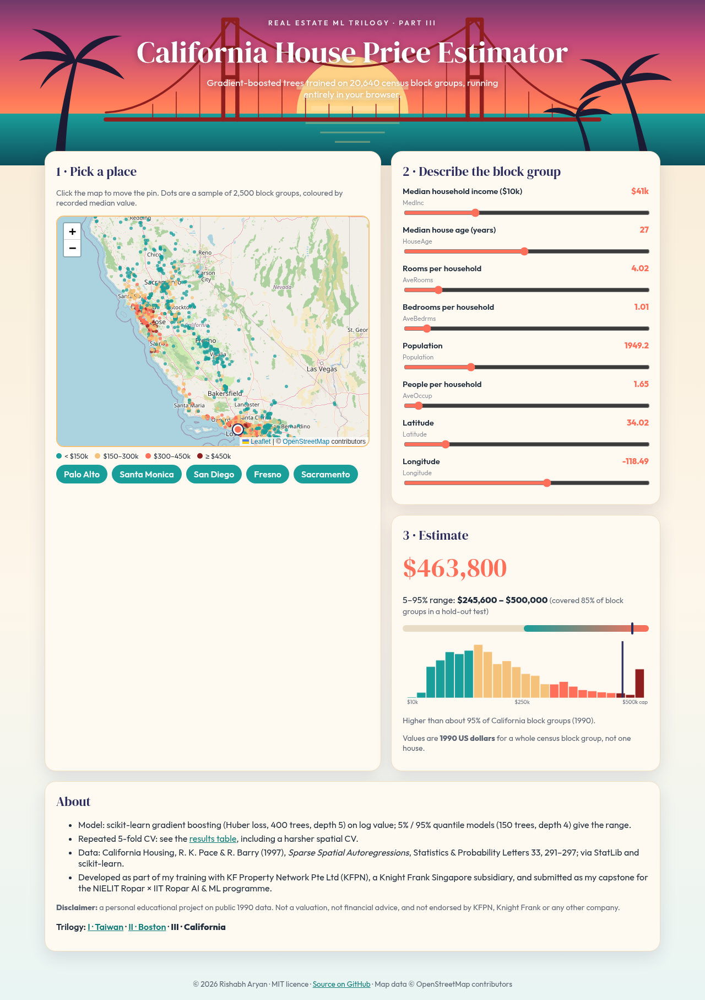
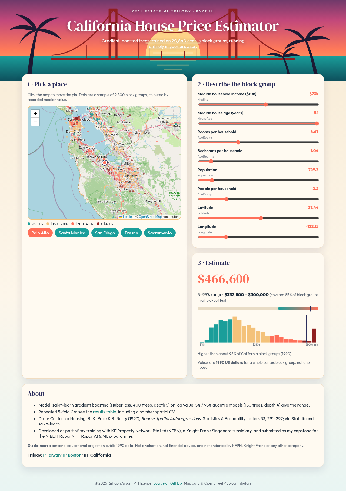
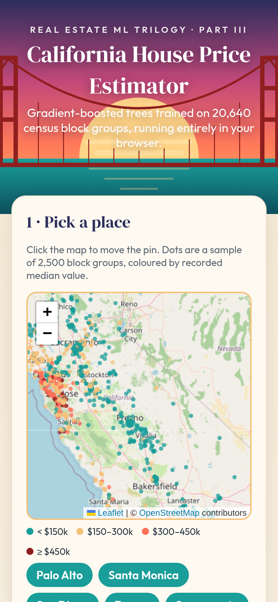

<div align="center">

# 🌴 California House Price Prediction: Machine Learning Regression in Python (scikit-learn, FastAPI) with a Live Map App

[](https://rishabh-bgp.github.io/california-house-price-prediction/)
[](https://github.com/Rishabh-bgp/california-house-price-prediction/actions/workflows/ci.yml)


**[▶ Open the live app](https://rishabh-bgp.github.io/california-house-price-prediction/)**



</div>

This is an end-to-end **machine learning regression project**. It predicts the **median house value of California census block
groups** from the **California Housing dataset** (1990 U.S. census, 20,640 block groups). It covers:

* EDA
* **repeated K-fold cross-validation** of linear, ridge, random-forest and gradient-boosting models
* a **spatial cross-validation** check
* handling of the **$500k top-code**
* **permutation importance** and quantile prediction ranges
* a **FastAPI** REST API, **Docker**, **pytest** and **GitHub Actions CI**
* a **GitHub Pages** web app with a **Leaflet / OpenStreetMap** map, where the gradient-boosted trees run in your browser

It is part III of my **Real Estate ML Trilogy**.

## 🎓 About this project
Developed as part of my training with **KF Property Network Pte Ltd (KFPN)**, a real estate agency associate business in
Singapore operating as a subsidiary of Knight Frank Singapore — a machine learning model for California, USA — and submitted as
my capstone for the **6-Month Joint Certification Program in AI & ML by [NIELIT Ropar](https://www.nielit.gov.in/ropar/)
with [IIT Ropar](https://www.iitrpr.ac.in/)**:

* Live, interactive sessions with NIELIT faculty
* Expert guest lectures from IIT Ropar professors on Natural Language Processing, Deep Learning and Neural Networks
* Hands-on lab access and project-based teaching
* A campus immersion visit to IIT Ropar

> **Disclaimer:** this is a personal portfolio project using a public dataset. It is not an official product of, and is
> not endorsed by, KFPN, Knight Frank or any other company. It is not a property valuation service, and the figures are
> 1990 values.

## 📊 Data
* **Source:** R. Kelley Pace and Ronald Barry (1997), "Sparse spatial autoregressions", *Statistics & Probability Letters*
  33(3): 291–297, [doi:10.1016/S0167-7152(96)00140-X](https://doi.org/10.1016/S0167-7152(96)00140-X). Distributed through the
  [StatLib repository](https://lib.stat.cmu.edu/datasets/) and loaded here with scikit-learn's
  [`fetch_california_housing`](https://scikit-learn.org/stable/modules/generated/sklearn.datasets.fetch_california_housing.html).
  A copy is saved as `data/california_housing.csv`.
* **Rows:** 20,640 census block groups (each typically 600–3,000 people).
* **Features (8):**
  * `MedInc`: median income, in $10k
  * `HouseAge`: median age, top-coded at 52
  * `AveRooms` and `AveBedrms`: averages per household
  * `Population`
  * `AveOccup`: people per household
  * `Latitude` and `Longitude`
* **Target:** `MedHouseVal`, the median house value in **$100,000** (1990 dollars).

### ⚠️ The $500k cap (top-code)
992 block groups (**4.8%**) have `MedHouseVal = 5.00001`. The census recorded every value of **$500,000 or more** as
the same number, so the true values of these rows are unknown and certainly higher. This is how the project handles it:

* **Kept in training.** Dropping them did not help on normal rows (hold-out RMSE 0.415 either way) and made them worse
  (1.052 → 1.166).
* **Predictions are clipped to 5.0** in the notebook, API and web app, because the data cannot support values above the cap.
* **Errors are reported separately:** the hold-out RMSE is **0.415** on uncapped rows and **1.052** on capped rows, where
  the label is only a lower bound. 74.5% of capped rows are predicted at $400k or more.
* **Flagged:** the API returns `at_top_code`, and the web app shows a note when an estimate reaches the cap.

Other known issues:
* `HouseAge` is also top-coded at 52 years.
* `AveRooms` and `AveOccup` have extreme outliers (block groups with few households, such as resorts or institutions).
* All values are from 1990.

## 📈 Results
These are from **repeated 5-fold CV** (`RepeatedKFold(5, n_repeats=3)`, which gives 15 folds), with predictions clipped at the
cap. Metrics are in **$100k**, shown as **mean ± std**, and come from the executed notebook:

| Model | RMSE | MAE | R² |
|---|---|---|---|
| **GBR, Huber loss, log target (deployed)** | **0.461 ± 0.009** | **0.291 ± 0.005** | **0.840 ± 0.006** |
| HistGradientBoosting, log target | 0.463 ± 0.011 | 0.294 ± 0.006 | 0.839 ± 0.008 |
| GBR, squared loss, log target | 0.467 ± 0.009 | 0.298 ± 0.005 | 0.836 ± 0.006 |
| Random forest | 0.501 ± 0.010 | 0.326 ± 0.006 | 0.811 ± 0.007 |
| Ridge, log target + log features | 0.659 ± 0.011 | 0.453 ± 0.007 | 0.674 ± 0.011 |
| Linear regression | 0.861 ± 0.543 | 0.527 ± 0.014 | 0.214 ± 1.502 |
| Ridge | 0.861 ± 0.543 | 0.527 ± 0.014 | 0.214 ± 1.502 |
| Mean baseline | 1.154 ± 0.013 | 0.912 ± 0.009 | 0.000 |

* The deployed model's RMSE of 0.461 is about **$46k**, and its MAE is about **$29k**.
* **The linear models have a huge std.** In one fold an extreme `AveOccup` / `AveRooms` outlier is extrapolated wildly. The
  log-feature ridge row shows that transforming the features fixes this. Trees are not affected.
* **Spatial CV is the honest number for unseen areas.** With 50 KMeans clusters of latitude/longitude held out as groups
  (`GroupKFold(5)`), the deployed model scores RMSE **0.592**, R² **0.721**, against ridge's 0.735 and 0.572. Random folds
  are optimistic because neighbouring block groups leak information.
* **Single 80/20 hold-out:** RMSE 0.463, MAE 0.292, R² 0.837.
* **5–95% quantile range:** it covered **84.8%** of hold-out block groups, below the nominal 90%, with a median width
  of $123k.
* **Permutation importance** (hold-out, increase in RMSE): Latitude 1.169, Longitude 1.085, MedInc 0.386,
  AveOccup 0.176, AveRooms 0.094, HouseAge 0.055, AveBedrms 0.006, Population 0.006. Location and income dominate.

## 🗺️ The web app
* The [live app](https://rishabh-bgp.github.io/california-house-price-prediction/) runs the exported trees in plain JavaScript. There is no server.
* **Map:** click the Leaflet / OpenStreetMap map to set the location. It shows a **sample of 2,500** of the 20,640 block
  groups, to keep the page light.
* **Inputs:** sliders for the other features, plus presets for Palo Alto, Santa Monica, San Diego, Fresno and Sacramento.
  Each preset uses the real block group nearest to that city.
* **Model size:** the full models export to about **1 MB of JSON**, so they are browser-friendly as they are. To keep them
  that size, the quantile models are smaller (150 trees, depth 4) than the point model (400 trees, depth 5). Nothing was
  downsampled after training.
* **Parity:** the JS and Python predictions agree to within **2e-14** on all 20,640 rows (checked with Playwright). Features
  are cast to float32 just as scikit-learn does.
* **Artwork:** all of it is original SVG (Pacific sunset gradient, palm silhouettes and suspension-bridge line art). There
  are no logos.

| Desktop | Mobile |
|---|---|
|  |  |

## 🚀 Quick start
```bash
git clone https://github.com/Rishabh-bgp/california-house-price-prediction.git
cd california-house-price-prediction
python -m venv .venv && source .venv/bin/activate
pip install -r requirements-dev.txt
python -m src.train              # trains, writes models/ and web/model.json, prints 5-fold CV RMSE
pytest -q                        # API, validation, cap and JSON-vs-sklearn parity tests
uvicorn app.main:app --reload    # http://127.0.0.1:8000/docs
```

```bash
curl -X POST http://127.0.0.1:8000/predict -H "Content-Type: application/json" \
  -d '{"MedInc":3.87,"HouseAge":29,"AveRooms":5.43,"AveBedrms":1.10,"Population":1166,"AveOccup":2.82,"Latitude":34.26,"Longitude":-118.49}'
```

**Docker:** `docker compose up --build` starts the API on port 8000 and the web app (nginx) on port 8080.

**Notebook:** the [`notebooks/`](notebooks/) folder is self-contained. It has its own data copy, requirements and README.

## 🗂️ Project structure
```
data/california_housing.csv      dataset (20,640 × 9)
notebooks/                       self-contained executed notebook + data + requirements
src/features.py                  feature list, $500k cap
src/train.py                     deployed model, joblib + JSON export
src/predict.py                   pure-Python JSON inference (mirrors web/app.js)
app/main.py                      FastAPI: /health, /predict
tests/                           pytest
web/                             GitHub Pages app (Leaflet map, in-browser trees)
docs/                            methodology, data, results, API, web app, deployment, FAQ
```

## 🏠 Real Estate ML Trilogy

Three capstone projects from my training with KF Property Network Pte Ltd (KFPN), each predicting home values in a different market with the same honest workflow: repeated K-fold CV, a log target, permutation importance, FastAPI, Docker, CI and an in-browser app.

| Part | Repository | Market and data | Live app | Deployed model, repeated K-fold CV |
|---|---|---|---|---|
| I | [real-estate-valuation-taiwan](https://github.com/Rishabh-bgp/real-estate-valuation-taiwan) | Xindian, New Taipei: 414 sales, 2012–13 | [▶ open](https://rishabh-bgp.github.io/real-estate-valuation-taiwan/) | R² 0.715, RMSE 7.136, MAE 4.551 (10k TWD per ping) |
| II | [boston-house-price-prediction](https://github.com/Rishabh-bgp/boston-house-price-prediction) | Boston: 506 census tracts, 1970 (race feature B excluded) | [▶ open](https://rishabh-bgp.github.io/boston-house-price-prediction/) | R² 0.877, RMSE 3.157, MAE 2.119 ($1000s) |
| III | [california-house-price-prediction](https://github.com/Rishabh-bgp/california-house-price-prediction) | California: 20,640 block groups, 1990 census | [▶ open](https://rishabh-bgp.github.io/california-house-price-prediction/) | R² 0.840, RMSE 0.461, MAE 0.291 ($100k) |

## 📚 Citation
```bibtex
@article{pace1997sparse,
  title   = {Sparse spatial autoregressions},
  author  = {Pace, R. Kelley and Barry, Ronald},
  journal = {Statistics \& Probability Letters},
  volume  = {33}, number = {3}, pages = {291--297}, year = {1997},
  doi     = {10.1016/S0167-7152(96)00140-X}
}
```

## 📄 Licence
The code is under the [MIT licence](LICENSE), © 2026 Rishabh Aryan. The dataset is not covered by it.

**Keywords:** California house price prediction, California housing dataset, machine learning, regression, gradient boosting,
scikit-learn, FastAPI, Docker, Leaflet, real estate data science, IIT Ropar, NIELIT Ropar.

## 🔗 Other repositories by Rishabh Aryan

| Repository | Description | Live |
|---|---|---|
| [100-days-of-python](https://github.com/Rishabh-bgp/100-days-of-python) | My original, offline, no-API-key solutions to all 100 projects of the 100 Days of Code Python bootcamp curriculum… | — |
| [Agentic-Engineering-Ebook](https://github.com/Rishabh-bgp/Agentic-Engineering-Ebook) | Agentic Engineering is a practical notebook-book on specifying, generating, verifying, and refining multi-tenant… | — |
| [beed-ml-study](https://github.com/Rishabh-bgp/beed-ml-study) | Provenance audit and leakage-aware benchmark of seizure-type classifiers on the Bangalore EEG Epilepsy Dataset — IIT… | — |
| [boston-house-price-prediction](https://github.com/Rishabh-bgp/boston-house-price-prediction) | Boston house price prediction with machine learning: scikit-learn gradient boosting, repeated K-fold CV, race… | [open](https://rishabh-bgp.github.io/boston-house-price-prediction/) |
| [Brain-Computer-Interfaces-and-Cognitive-Computing-An-Introduction](https://github.com/Rishabh-bgp/Brain-Computer-Interfaces-and-Cognitive-Computing-An-Introduction) | Brain–computer interfaces (BCIs) link neural activity to external devices, translating brain signals via algorithms… | — |
| [building-a-virtual-cell-in-python](https://github.com/Rishabh-bgp/building-a-virtual-cell-in-python) | A cell has a normal gene-activity pattern. Knock out one gene and that pattern changes. This project trains a small… | — |
| [Chronic-Kidney-Disease-Stage-Identification-in-HIV-Infected-Patients-Using-Supervised-ML](https://github.com/Rishabh-bgp/Chronic-Kidney-Disease-Stage-Identification-in-HIV-Infected-Patients-Using-Supervised-ML) | ML is transforming Chronic Kidney Disease (CKD) detection in HIV patients, catching early asymptomatic stages to… | — |
| [cobratate](https://github.com/Rishabh-bgp/cobratate) | Cobratate, an esoteric imperative programming language. Tate-flavored syntax, ordinary semantics, and a Python… | [open](https://rishabh-bgp.github.io/cobratate/) |
| [coda-synth](https://github.com/Rishabh-bgp/coda-synth) | CoDA-Synth: stylometric detection of LLM-rewritten dark-web documents with sparse TF-IDF + LinearSVC. Research lab,… | [open](https://shale-ember-delta-kite.grok.me/) |
| [IIT-ROPAR-GENAI-FOUNDATIONS](https://github.com/Rishabh-bgp/IIT-ROPAR-GENAI-FOUNDATIONS) | Free open-source Generative AI foundations ebooks (2026) covering Claude, Grok, Gemini, Cursor, OpenAI and more —… | — |
| [iris-classification](https://github.com/Rishabh-bgp/iris-classification) | Iris flower classification in Python: scikit-learn model comparison, tuning and evaluation, FastAPI /predict API,… | [open](https://rishabh-bgp.github.io/iris-classification/) |
| [kbc-game](https://github.com/Rishabh-bgp/kbc-game) | Kaun Banega Crorepati (KBC) quiz game for the terminal in Python: 16-question prize ladder, safe levels and 4… | — |
| [knn-classifier](https://github.com/Rishabh-bgp/knn-classifier) | Simple K-Nearest Neighbors classifier on the classic Iris dataset using scikit-learn. Loads data, trains the model,… | — |
| [linear-regression-model-](https://github.com/Rishabh-bgp/linear-regression-model-) | Supervised linear regression on the scikit-learn diabetes dataset. A single feature (BMI) is used to predict… | — |
| [logistic-regression](https://github.com/Rishabh-bgp/logistic-regression) | This graduate capstone applies multi-class logistic regression to the Iris dataset. It includes EDA, stratified… | — |
| [logistics-website-capstone](https://github.com/Rishabh-bgp/logistics-website-capstone) | Logistics website capstone: Kargonaut Logistics, a premium freight site mixing claymorphism, glassmorphism and… | [open](https://rishabh-bgp.github.io/logistics-website-capstone/) |
| [lovelight-leap](https://github.com/Rishabh-bgp/lovelight-leap) | 💖 Lovelight Leap: a love-themed 2D platformer in vanilla JS canvas. 4 worlds, a boss you cheer up, original… | [open](https://rishabh-bgp.github.io/lovelight-leap/) |
| [machine-learning-part-1](https://github.com/Rishabh-bgp/machine-learning-part-1) | Machine learning in Python with scikit-learn: heart disease classification and medical insurance cost regression… | — |
| [Meeting-of-Machines-Consumer-Agents-Seller-Agents-and-Hidden-Fulfilment-Risk-in-Online-Retail](https://github.com/Rishabh-bgp/Meeting-of-Machines-Consumer-Agents-Seller-Agents-and-Hidden-Fulfilment-Risk-in-Online-Retail) | Agentic commerce lets shopping and seller agents place orders without showing operational truth. This IS case argues… | — |
| [morocco-city-aware-load-forecasting](https://github.com/Rishabh-bgp/morocco-city-aware-load-forecasting) | City-aware short-term load forecasting and peak detection on high-resolution Moroccan smart-meter data (5 zones).… | — |
| [NIELIT-DATA-SCIENCE](https://github.com/Rishabh-bgp/NIELIT-DATA-SCIENCE) | Hands-on NumPy, Pandas, and Matplotlib Jupyter notebooks for the NIELIT Data Science curriculum — practical,… | — |
| [NIELIT-MACHINE-LEARNING-PROJECTS](https://github.com/Rishabh-bgp/NIELIT-MACHINE-LEARNING-PROJECTS) | Nineteen end-to-end machine learning projects: classification, regression, clustering, and recommendation, with… | — |
| [NIELIT-PYTHON-](https://github.com/Rishabh-bgp/NIELIT-PYTHON-) | Open-source Python teaching notebooks: a language reference and five capstone programs, with detailed documentation.… | — |
| [pan-cancer-classification](https://github.com/Rishabh-bgp/pan-cancer-classification) | Leakage, equivalence, conformal reliability and data efficiency on the UCI TCGA Pan-Cancer RNA-Seq dataset — IIT… | — |
| [Predicting-Hot-Events-in-the-Early-Period-through-Bayesian-Model-for-Social-Networks](https://github.com/Rishabh-bgp/Predicting-Hot-Events-in-the-Early-Period-through-Bayesian-Model-for-Social-Networks) | This notebook details the implementation and evaluation of a Bayesian perspective Early stage Event Prediction… | — |
| [prediction-as-power](https://github.com/Rishabh-bgp/prediction-as-power) | Laboratory and working paper on prediction as power in European electricity markets. A DE-like hourly simulator… | — |
| [real-estate-valuation-taiwan](https://github.com/Rishabh-bgp/real-estate-valuation-taiwan) | Taiwan real estate valuation (Xindian, New Taipei): house price per ping prediction with scikit-learn gradient… | [open](https://rishabh-bgp.github.io/real-estate-valuation-taiwan/) |
| [snakes-and-ladders](https://github.com/Rishabh-bgp/snakes-and-ladders) | 🐍🪜 Original Snakes & Ladders browser game: hand-drawn SVG snakes and ladders, 3D dice, 2-4 humans or bots, sound,… | [open](https://rishabh-bgp.github.io/snakes-and-ladders/) |
| [spam-scan](https://github.com/Rishabh-bgp/spam-scan) | Explainable spam, phishing & Indian-scam detector for SMS/email (English, Hindi, Hinglish): TF-IDF + Logistic… | [open](https://spam-scan.onrender.com) |
| [vedic-math-hybrid-kt](https://github.com/Rishabh-bgp/vedic-math-hybrid-kt) | Hybrid Vedic Math AI: rule-based sutras (Urdhva-Tiryagbhyam, Nikhilam, Yavadunam) plus RF classifier that cleans… | — |
| [wind-turbine-power-model](https://github.com/Rishabh-bgp/wind-turbine-power-model) | Single-turbine power curves + wind-farm simulation. Weibull wind stats, hourly NASA-style speed data, and… | — |
| [zoo-website-capstone](https://github.com/Rishabh-bgp/zoo-website-capstone) | Capstone project: a fictional zoo website built twice — a beginner-style simple version and a cinematic advanced… | [open](https://rishabh-bgp.github.io/zoo-website-capstone/) |
